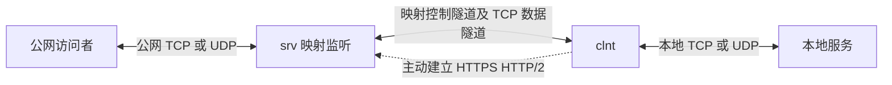
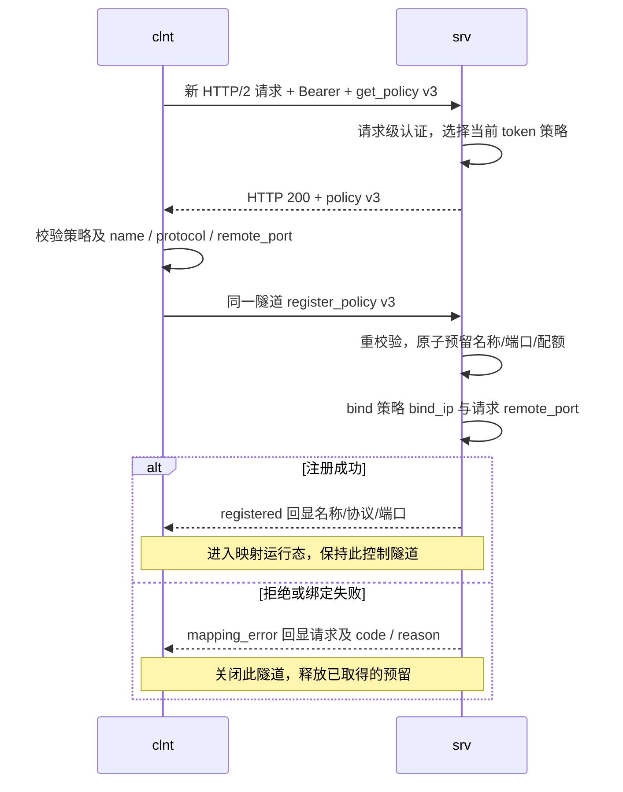
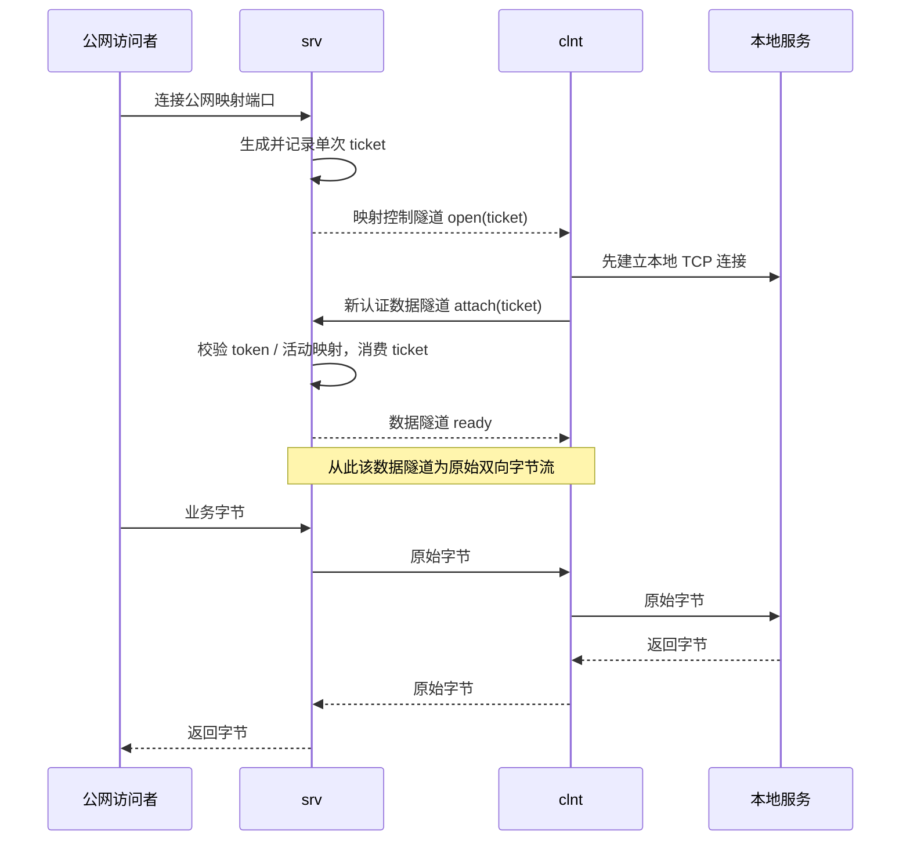
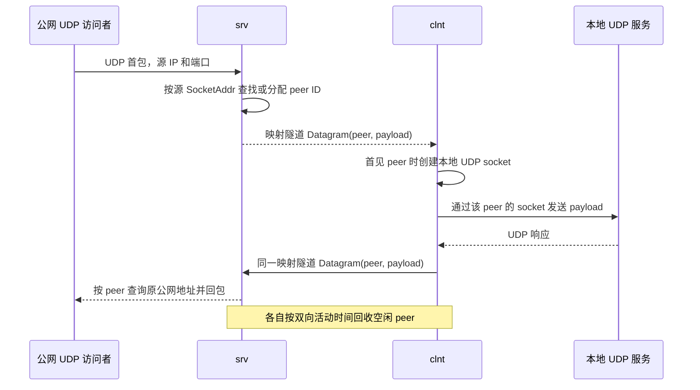
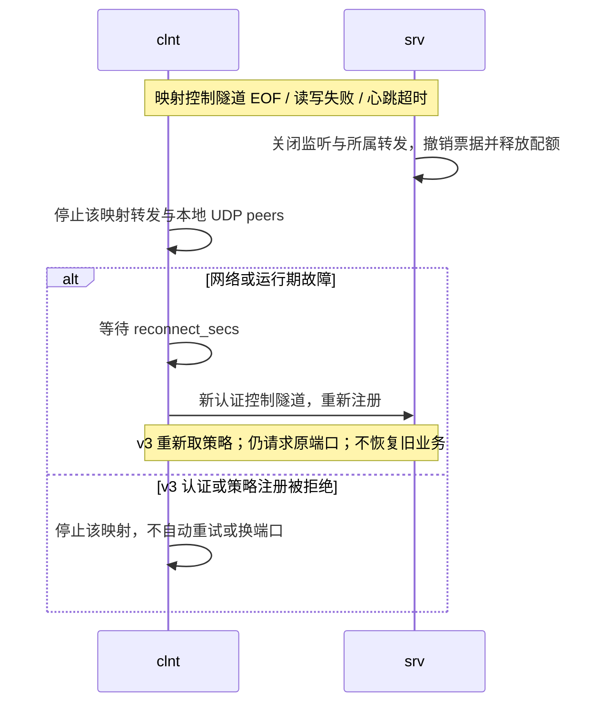

# RVNX 通信协议

本文描述当前实现的通信、认证、消息格式和资源生命周期，可用于实现互通客户端和排查故障。静态注册使用 v2，按令牌策略注册使用 v3；二者共用 HTTPS HTTP/2 传输、TCP 票据接入和 UDP 数据报编码。v3 不是新的 TLS 或 HTTP 版本，也没有新增登录会话。

配置入口见 [README](../README.md)、[策略客户端样例](../examples/clnt.policy.toml)、[策略服务端样例](../examples/srv.policy.toml)。Cloudflare 主备调度和部署参数见 [CF 模式](cloudflare.md)。以下行为以本地当前源码为准，不表示已发布到远端或已通过真实 CDN 路径验证。

**未发布 v3 兼容性说明：** 本次为 TCP Open 增加 `timeout_ms` 字段和服务端发送 Cancel 的语义，早期本地严格解码的 v3 二进制不接受它。该 v3 尚未发布，需要同时更新两端；不是与早期本地 v3 的无缝线协议兼容升级。v2 Open 仍省略该字段，JSON 形式不变。

## 1 角色与通道

| 角色或通道 | 职责与边界 |
| --- | --- |
| 公网访问者 | 连接 `srv` 的 TCP/UDP 映射端口；不参与 RVNX Bearer 认证。业务自身的鉴权仍由被代理服务负责。 |
| 服务端 `srv` | 接受客户端隧道，按请求认证，分配/绑定公网监听，管理 TCP 票据及 UDP peer。 |
| 客户端 `clnt` | 主动向服务端建立出站连接，注册映射，将业务转到配置的 `local` 地址。 |
| 本地服务 | 接受客户端发起的本地 TCP 连接或 UDP 数据报；无需理解 RVNX。 |
| 映射控制隧道 | 每个映射一个长期双向 HTTP/2 请求/响应流；承载注册、心跳、TCP `open`/`cancel`，或该映射的全部 UDP 数据报。 |
| TCP 数据隧道 | 每条公网 TCP 连接一个新 HTTP/2 流；独立认证并以 `attach` 接入，`ready` 后只传业务字节。 |
| 外层连接 | TCP + TLS + HTTP/2；可以只承载一条隧道，也可以复用多条。外层连接不是身份或映射的边界。 |



默认直连不复用：每个控制隧道和每条 TCP 数据隧道分别建立外层连接。显式 `multiplex = true` 可使用连接池；CF 模式使用 gRPC 共享主备传输。复用不改变消息顺序、逐请求认证或映射归属。UDP 不为每个访客另建 TLS 连接。

## 2 TLS 与每请求认证

### 2.1 请求和响应

客户端先建立 TCP/TLS，校验服务器证书与 `server_name`，协商 ALPN `h2`。`tls_ca` 为空时使用内置公共根证书，否则使用配置的 CA；服务端不要求客户端证书。Bearer 认证发生在 TLS 内，不能替代证书校验。

| 端点 | 请求 | 成功响应 | 正文 |
| --- | --- | --- | --- |
| `/api/stream` | `POST`，`content-type: application/octet-stream` | HTTP 200，同内容类型 | 双向 RVNX 字节流 |
| `/rvnx.Tunnel/Connect` | `POST`，`content-type: application/grpc+proto` | HTTP 200，同内容类型 | 双向 gRPC `Chunk` 流，内部承载相同 RVNX 字节流 |
| `/rvnx.Tunnel/Download` | 同 gRPC 请求，仅在 `cf_probe_enabled = true` 时开放 | HTTP 200，gRPC 流 | 认证测速/保活，不是映射控制隧道 |

三个端点的**每个请求**都必须带 `authorization: Bearer <token>`。`Bearer ` 前缀按字节匹配，大小写和空格必须一致；令牌不放在 JSON 中。客户端将认证头标记为敏感，避免进入 HPACK 动态索引。服务端对 gRPC 接受精确的 `application/grpc` 或 `application/grpc+proto`；原始 `/api/stream` 路由当前不额外校验内容类型，互通客户端仍应发送上表值。

HTTP/2 请求头示例（占位值不是可用凭据）：

```text
:method: POST
:scheme: https
:authority: tunnel.example:443
:path: /api/stream
content-type: application/octet-stream
authorization: Bearer <configured-token>
```

请求和响应正文均保持流式打开。客户端可将首条 RVNX 控制消息与请求头一起发送，无需先等待 HTTP 200；服务端通过认证后才解析 RVNX 消息。HTTP 200 仅说明请求被接收，**不代表映射注册或 Attach 成功**。

- 缺失/错误令牌、非 POST、未知端点、关闭的 Download、gRPC 路由内容类型不匹配：普通 HTTP `404 Not Found`，正文 `Not Found\n`，不返回 RVNX 错误细节。HTTP/1.1 访问也返回普通 404。
- 已认证隧道的分发队列满：HTTP `503 Service Unavailable`。超过外层连接总上限时新 TCP 连接会直接关闭，不保证 HTTP 响应。
- HTTP 404 故意不区分凭据和端点错误；客户端日志中的 `authentication_rejected` 也可能是路径/模式不匹配，不能据此断言一定是密钥错误。
- 一条 HTTP/2 连接可承载不同 token 的请求。每次 Attach 也必须认证；连接曾认证成功不构成后续请求的授权。

### 2.2 身份和策略边界

**token 本身就是身份**，没有额外用户、principal、登录会话、刷新令牌或独立认证握手。服务端配置令牌长度为 32–4096 字节，只允许可见 ASCII，禁止示例占位值。换 token 即换身份。

| 模式 | 服务端配置 | 客户端注册 | 权限与名称范围 |
| --- | --- | --- | --- |
| 静态 v2 | `token` 或 `tokens`，加 `[[proxies]]` | `register(version=2)` | 所有令牌权限相同，均可注册已配置映射；名称全服务端独占。 |
| 策略 v3 | 仅 `[[policies]]`，与顶层令牌/静态映射互斥 | `get_policy` 后同流 `register_policy`，均 `version=3` | 每 token 一份策略；同 token 名称唯一，不同 token 可同名；端口冲突仍全局检查。 |

原 v2 配置不需要迁移。v3 客户端必须显式 `policy_mode = true`，每个映射指定 `remote_port`；不存在自动降级或失败后自动选端口。两种模式仍共用 v2 引入的 HTTPS 传输，与旧的直接 TLS 自定义 v1 不兼容。

策略响应仅包含当前 token 的策略，不发送 token 或其他身份。策略只在客户端当前握手内存中使用，不落盘；每次重连重新获取。配置和令牌都不热加载，修改/撤销需重启相应进程；服务端重启会断开现有隧道。

## 3 注册与转发时序

### 3.1 静态注册

客户端为每个映射打开一个认证隧道，首条发送 `register`。服务端检查版本、配置中的映射名称和协议、是否已占用，然后预留名称并绑定配置地址。绑定成功后由**服务端**回复 `ready`；失败回复 `error` 后关闭该隧道。此处 `ready` 表示 v2 映射就绪，不是 TCP 数据 Attach 的确认。

### 3.2 策略注册



本地检查不预占服务端配额；服务端始终独立重校验。`bind_ip` 仅由服务端策略决定，客户端请求没有覆盖字段。`registered` 只在 bind 成功后发出，监听可能已在确认到达前存在；客户端必须等匹配的确认才能认为注册成功。

名称、精确 `(protocol, bind_ip, port)` 和同身份配额在一次锁内原子预留，覆盖异步 bind 的竞争窗口。`max_mappings` 包含同 token 所有客户端的活动映射和正在绑定的预留；本地逐映射预校验不为配置条目安排优先级；配置条目总数超过配额时，并发注册胜出顺序不保证，超额请求明确收到 `quota_exceeded`，不会替换成功映射。TCP 与 UDP 可使用同一数字端口。通配地址与具体地址的重叠由操作系统 bind 最终裁决，可能得到 `bind_failed` 而不是 `port_in_use`。

### 3.3 每条 TCP 业务连接



顺序是 **Open → 本地 connect → 新隧道 Attach → 服务端 Ready → 双向转发**。`registered` 只用于 v3 映射注册；两种模式的 TCP Attach 成功均回复 `ready`，不回复 `registered`。

- ticket 是服务端生成的 32 随机字节的小写十六进制字符串（64 字符），绑定创建它的 token 和映射实例，只能成功消费一次。客户端应将其视为不透明字符串。
- Attach 先检查所有权、映射仍活动及票据单调时钟截止时间，再消费票据。其他 token 的尝试收到 `error`，不能销毁合法票据；旧映射票据不能用于之后的同名映射。
- 客户端达到连接上限、本地连接失败、Attach/转发任务失败时，在原控制隧道发 `cancel(ticket)`；没有单独的 Cancel 确认。仅同映射可撤销尚未消费的票据。同 token 的其他映射也不能撤销。已消费或不存在的票据被忽略，Cancel 不是已建立业务连接的远程关闭指令。
- 服务端达到连接上限时直接关闭新公网 TCP 连接，不发 Open。等待 Attach 超时则关闭该公网连接、移除票据。已建立的数据连接失败通常只结束该业务，不注销整个映射。
- Ready 后**不再使用 RVNX 长度前缀、帧类型或控制 JSON**，也不在该数据流发 Ping/Pong。gRPC 模式仍保留外层 `Chunk` 封装。
- 双端使用双向复制并保留半关闭：一方读到 EOF，关闭对向写端，反向仍可继续发送至完成。HTTP/2 用该方向的 `END_STREAM` 表示写关闭；gRPC 服务端正常结束以 `grpc-status: 0` trailers 结束响应。不要把单方向 EOF 当作立即销毁双向业务。

#### TCP 建连总预算

服务端在接受公网 TCP 连接时启动一个 `connection_wait_secs` 总预算，涵盖 Open 排队/通知、等待 Attach、Attach Ready 写出；这些阶段不会各自重新获得完整预算。超时仅关闭这一条业务连接并撤销票据，映射监听和其他业务继续运行。静态模式沿用各 `[[proxies]]` 的该字段；策略模式使用**服务端顶层** `connection_wait_secs`，默认 10 秒、范围 1–600。该字段是服务端运行参数，不属于发给客户端的权限 Policy。

v3 的 Open 必须携带剩余 `timeout_ms`（相对毫秒数，服务端发送范围 1–600000）。客户端对缺失或超过 600000 的值视为协议不匹配；值为 0 时只立即结束本次建连。客户端收到后用一个预算覆盖本地 TCP connect、CF 排队、隧道打开以及等待 Attach Ready；不是每一步各等待一次完整预算。各阶段已有更短超时仍可能先到期。服务端的单调时钟截止时间始终为最终裁决：消息携带的剩余量无法扣除随后在网络中的飞行时间，双端不宣称共享精准同步的绝对截止时间。

v3 服务端在建连失败/过期时还尝试在控制流非阻塞发送 `cancel(ticket)`，提示客户端停止尚未完成的建连；队列满时该提示可丢弃，客户端仍有自己的总预算兜底。客户端只在本地 connect/排队/Attach Ready 阶段监听此取消信号，Ready 后取消通道被释放，迟到的 Cancel 不会杀死已经建立的数据流。没有为取消新增确认或补发；v2 不发送这种服务端 Cancel。 v3 客户端在拒绝或结束建连任务时同样非阻塞尽力发送 Cancel，避免清理任务因满队列再等待额外超时、继续占用连接名额。

服务端发送的 v2 Open 不带 `timeout_ms`，保留原 JSON 形式；v2 客户端不能凭不存在的字段推导远端总预算，但服务端同样按从 accept 起算的总预算清理。Ready 成功后的原始双向业务复制**不受这段建连预算限制**，模型首段或空闲业务可超过它，只要控制隧道和链路保持健康。

### 3.4 UDP peer 与数据报



服务端在每个 UDP 映射内从 1 开始递增分配 `u64` peer ID，以公网源 IP+端口区分访客；回收后同一地址再次来包会得到新 ID。ID 不在映射间通用，耗尽会结束该映射。客户端每个 peer 建一个连接到配置目标的本地 UDP socket，本地服务看到的是客户端 socket 地址，不保留公网源地址。

双方在任一方向活动后更新时间；服务端每秒清理，客户端每 peer 按空闲截止时间退出。没有显式 UDP Open/Close/Cancel 消息，也没有每包票据。未知/已回收 peer 的客户端回包在服务端被忽略。客户端 peer 独立回收后，之后收到同 ID 的新包可重建本地 socket。

允许空数据报，最大载荷 65,507 字节；从公网或本地 UDP socket 收到的超长数据报被丢弃。对端发送超出帧长上限的 RVNX Datagram 则是协议错误，会结束该映射，不能按普通丢包处理。peer 数达到本端限制时，新 peer 的包被丢弃；数据报发送队列或客户端单 peer 队列满时也丢包，不阻塞所有访客。客户端单 peer 队列为 64，隧道帧队列为 128。此行为不是可靠 UDP 协议：没有应用级确认、重传或跨重连恢复；外层 TCP 的可靠性反而会造成丢包重传时的队头等待。

### 3.5 断线与重连



重连不是恢复旧会话：映射实例、TCP 票据、UDP peer 表和所有业务连接都重新建立。不同映射独立运行；同一外层连接实际断开会影响其承载的所有流，可能让多个映射一起重连。CF 的计划主备轮换只将新流切到新连接，旧流仍持有旧连接；它不等同于控制隧道断线，不应主动清理旧流。

## 4 字节流与封装

HTTP/2 DATA 边界、gRPC Chunk 边界与 RVNX 帧边界**没有一一对应关系**。实现必须缓冲拆包/粘包：一帧可跨多个 DATA/Chunk，一个 DATA/Chunk 也可包含多帧或帧的一部分。

### 4.1 RVNX 控制帧与 UDP 帧

所有整数为无符号、大端（网络字节序）。长度 `L` **不含自身的 4 字节，包含帧类型和其余内容**。

```text
控制帧
+----------------+------+-------------------------------+
| L: u32 BE      | 0x01 | UTF-8 JSON，恰好 L - 1 字节    |
+----------------+------+-------------------------------+
  L = 1 + JSON 字节数，JSON 最多 8192 字节

UDP 帧
+----------------+------+----------------+--------------+
| L: u32 BE      | 0x02 | peer: u64 BE   | UDP payload  |
+----------------+------+----------------+--------------+
  L = 9 + payload 字节数，payload 为 0..65507 字节
```

统一帧长校验是 `1 <= L <= 65516`；控制帧还要求 `L <= 8193`，UDP 帧要求 `L >= 9`。不满足长度、未知帧类型、截断、无效 UTF-8/JSON、未知消息类型或字段解析失败会导致当前隧道失败；不保证能返回结构化 `error`。

例如 Ping 的紧凑 JSON `{"type":"ping"}` 为 15 字节，完整帧为：

```text
00 00 00 10 01 7b 22 74 79 70 65 22 3a 22 70 69 6e 67 22 7d
```

peer=1、载荷为 ASCII `hi` 的完整 UDP 帧为：

```text
00 00 00 0b 02 00 00 00 00 00 00 00 01 68 69
```

TCP 数据隧道只在 Attach/Ready 阶段使用控制帧；Ready 后剩余字节均为业务字节，即使恰好看起来像控制帧也不再解析。

### 4.2 gRPC 外层

协议声明见 [rvnx.proto](../proto/rvnx.proto)。`Connect` 是双向流 RPC，protobuf 消息为：

```proto
syntax = "proto3";
package rvnx;
message Chunk { bytes data = 1; }
service Tunnel {
  rpc Connect(stream Chunk) returns (stream Chunk);
  rpc Download(Chunk) returns (stream Chunk);
}
```

每个 gRPC 消息在线上的结构是：

```text
0x00 | protobuf_message_length:u32 BE | protobuf Chunk
Chunk 常规非空编码：0x0a | data_length:protobuf varint | data bytes
```

首字节为压缩标志，只允许 0。长度是 protobuf 消息长度，不是 `data` 长度；protobuf 字段标签 `0x0a` 表示字段 1、wire type 2。把各个 Chunk 的 `data` 顺序拼接后，得到第 4.1 节的字节流或 Ready 后的 TCP 原始字节流。空 Chunk 不等于 EOF；流终止由 HTTP/2/gRPC 结束语义决定。

当前写端将 data 切成最多 32 KiB 的 Chunk；读端接受的 protobuf 消息最大 32 KiB + 16 字节（32784），拒绝压缩消息。发送端应遵循每块 data 不超过 32768 字节，较大的 UDP 帧必须分块。客户端发送 `te: trailers`、`grpc-accept-encoding: identity`、`cache-control: no-store`；正常响应末尾必须有 `grpc-status: 0`，当前客户端对缺失或非零结束状态报错。非正常关闭不保证有完整 trailers，不能仅看 HTTP 200 判断成功。

### 4.3 Download 测速与保活

Download 也逐请求校验相同 Bearer。请求是一个 `Chunk`，`data` 恰好为 4 字节大端 `u32` 的期望下载字节数，发送后关闭请求写端。不要在里面加 RVNX 长度或类型字段。服务端按解码后的流检查恰好 4 字节并等到 EOF；无额外字节的 Chunk 分片不会改变其结果。

范围为 `0..16777216`（0 到 16 MiB）。响应 Chunk 拼接后恰好为请求字节数的随机业务无关数据，结束状态为 0；0 字节用于认证端到端轻量保活。请求超长、额外输入或 60 秒总处理超时会使该请求失败，不保证结构化状态。全服务端最多并发 4 个 Download（含零字节请求），无容量时 HTTP 200 后以 `grpc-status: 8` 结束。该限制不消耗策略 `max_mappings`，也不会创建映射或票据。

CF 模式只把外层 TCP 目标替换为候选 IP，仍保留配置域名的 SNI、证书校验和 HTTP authority；代理终止 TLS 时能看到认证头和隧道内容，并非 clnt 到 srv 的额外端到端加密。主备预算、排队和测速参数是客户端传输策略，不是新增控制消息；详见 [CF 模式](cloudflare.md)。

## 5 控制 JSON 字段规范

所有控制消息都是对象，必填 `type: string`，值为下表的小写蛇形名称。除特别标为可选的 `open.timeout_ms` 外，表中列出的字段均必填，无默认值。已知消息类型忽略未知字段，包括 `policy` 和嵌套端口区间对象中的扩展字段；已知字段的类型、必填项、取值和业务约束仍会严格校验。未知 `type` 不是可忽略的扩展消息，仍是协议错误。整数必须为 JSON 整数，不能使用字符串、负数或小数；`u16` 范围为 0–65535，业务校验可能更严格。消息不包含 token。

这种容忍只适用于可忽略的附加信息，不提供版本协商、自动降级或“未知就允许”的权限语义。新增必需字段、更改既有字段含义或安全边界仍须定义明确的版本行为；不能仅添加一个会被旧端忽略的安全限制，就宣称旧端已经执行它。未知字段不会覆盖同名已知字段，也不会让缺失或错误类型的必填字段通过校验。

### 5.1 全部消息

| `type` | 方向与用途 | 除 `type` 外的必填字段与约束 |
| --- | --- | --- |
| `register` | C → S，v2 映射注册 | `version: u16 = 2`；`proxy: string` 为已配置名称；`protocol: string` 必须与配置的 `tcp` 或 `udp` 一致。 |
| `get_policy` | C → S，v3 控制隧道首条 | `version: u16 = 3`。 |
| `policy` | S → C，策略响应 | `version: u16 = 3`；`policy: object`，见下表。 |
| `register_policy` | C → S，同流已取策略后注册 | `version: u16 = 3`；`proxy: string`；`protocol: "tcp" 或 "udp"`；`remote_port: u16`，业务要求非零且在允许区间。 |
| `registered` | S → C，v3 注册成功 | `proxy: string`；`protocol: "tcp" 或 "udp"`；`remote_port: u16`。必须与请求三项完全一致。 |
| `mapping_error` | S → C，v3 注册拒绝 | 同上三项，回显被拒绝的请求；另有 `code: string`、`reason: string`。服务端保证非空，见错误表。 |
| `attach` | C → S，新 TCP 数据隧道首条 | `ticket: string`，使用 Open 收到的票据；无 `version`、映射名或端口。 |
| `open` | S → C，已注册 TCP 控制隧道 | `ticket: string`；可选 `timeout_ms: u64` 为剩余建连预算毫秒。当前 v3 服务端发送，v2 省略。 |
| `cancel` | C → S；v3 也可 S → C，所属 TCP 控制隧道 | `ticket: string`。C → S 撤销待接入票据；v3 S → C 提示终止尚未完成的建连，不终止已经 Ready 的业务。 |
| `ready` | S → C，v2 注册或任意模式 Attach 成功 | 无其他字段。 |
| `error` | S → C，握手层拒绝 | `message: string`，诊断文本；没有稳定机器码，不应靠文本解析错误类别。 |
| `ping` | C ↔ S，映射运行态心跳 | 无其他字段；接收方回复 Pong。 |
| `pong` | C ↔ S，心跳响应 | 无其他字段；无请求 ID、序号或时间戳。 |

`proxy` 的业务约束为 1–64 字节，只允许 ASCII 字母、数字、`-`、`_`。v2 对输入名称先按服务端配置查找；服务端配置本身已校验名称。v3 双方都调用同样的名称/协议/端口校验。JSON 可表示 `remote_port=0`，但策略注册会拒绝它，错误响应仍回显 0。`register.protocol` 的解码类型是普通字符串；v3 消息的 protocol 为枚举，未知值在解码时就失败。

除名称和策略的业务限制外，`ticket`、`message`、`code`、`reason` 没有独立的线长上限，共同受 8192 字节 JSON 上限约束。当前客户端对匹配请求的 `mapping_error` 直接接受 code/reason 字符串，并未额外验证非空；非空是当前服务端的输出保证。

### 5.2 policy 对象

| 字段 | JSON 类型 | 当前校验与含义 |
| --- | --- | --- |
| `bind_ip` | string | 合法 IPv4 或 IPv6 字面地址，不带端口；服务端控制，不能由注册请求覆盖。 |
| `allowed_ports` | array of object | 1–128 个闭区间；每项必填 `start: u16`、`end: u16`，满足 `1 <= start <= end <= 65535`；区间可不排序，但不能重叠。 |
| `protocols` | array of string | 非空，只允许 `tcp`、`udp`，不得重复。 |
| `max_mappings` | integer | 1–4096，同 token 跨客户端的并发映射/预留总上限。 |

在线 Policy 和端口区间对象忽略未知字段，然后对已知策略字段执行原有校验；已知策略自身紧凑 JSON 序列化后不得超过 4096 字节，为控制消息外层留余量。无论是否包含扩展字段，整条控制帧仍须遵守 8192 字节 JSON 上限。本地 TOML 配置不使用这条宽松规则：未知配置键仍拒绝，以便发现拼写错误。

### 5.3 完整消息示例

以下每个 `json` 代码块都是一条完整控制消息；实际发送时还必须添加第 4.1 节的帧头。示例映射为 `web`、TCP 20080；票据为格式示意，不是真实可用票据。

v2 静态注册请求与成功响应：

```json
{"type":"register","version":2,"proxy":"web","protocol":"tcp"}
```

```json
{"type":"ready"}
```

v3 策略获取请求与响应：

```json
{"type":"get_policy","version":3}
```

```json
{"type":"policy","version":3,"policy":{"bind_ip":"0.0.0.0","allowed_ports":[{"start":20000,"end":20100}],"protocols":["tcp","udp"],"max_mappings":4}}
```

同一隧道上的 v3 注册请求与成功响应：

```json
{"type":"register_policy","version":3,"proxy":"web","protocol":"tcp","remote_port":20080}
```

```json
{"type":"registered","proxy":"web","protocol":"tcp","remote_port":20080}
```

同一注册请求被拒绝时的替代响应，不与成功响应同时发送：

```json
{"type":"mapping_error","proxy":"web","protocol":"tcp","remote_port":20080,"code":"quota_exceeded","reason":"mapping name, port or quota is unavailable"}
```

TCP 控制流 v3 Open，以及另一个新认证隧道的 Attach（v2 Open 省略 `timeout_ms`）：

```json
{"type":"open","ticket":"0123456789abcdef0123456789abcdef0123456789abcdef0123456789abcdef","timeout_ms":9500}
```

```json
{"type":"attach","ticket":"0123456789abcdef0123456789abcdef0123456789abcdef0123456789abcdef"}
```

成功回复 `{"type":"ready"}` 后开始原始业务字节；失败的完整响应示例：

```json
{"type":"error","message":"invalid or expired ticket"}
```

本地 connect 失败等情况下，在原控制流撤销待处理票据：

```json
{"type":"cancel","ticket":"0123456789abcdef0123456789abcdef0123456789abcdef0123456789abcdef"}
```

映射心跳请求与响应：

```json
{"type":"ping"}
```

```json
{"type":"pong"}
```

UDP 映射注册只需将对应请求的 `protocol` 改为 `udp`；注册成功后直接使用二进制 Datagram 帧，不发送 Attach，也没有 JSON `datagram` 消息。

## 6 状态与合法顺序

### 6.1 服务端接收状态

| 状态 | 允许收到 | 响应与转移 |
| --- | --- | --- |
| 新认证隧道，尚无首条控制消息 | 静态模式 `register(version=2)` | 成功发 Ready 后进入 TCP/UDP 映射运行态；失败 Error 并结束。 |
| 同上 | 策略模式 `get_policy(version=3)` | 发 Policy，等待同流下一条控制消息。 |
| 同上 | 任意模式 `attach` | 校验并消费 ticket；成功发 Ready 后移交原始 TCP 数据转发；失败 Error。 |
| 已返回 Policy | `register_policy(version=3)` | 通过复核、预留和 bind 后发 Registered；否则 MappingError 并结束。 |
| TCP 映射运行态 | Ping、Pong、Cancel | Ping 回复 Pong；Pong 无进一步响应；Cancel 只撤销本映射未消费票据。 |
| UDP 映射运行态 | Datagram、Ping、Pong | Datagram 按 peer 回包；Ping 回复 Pong；Pong 无进一步响应。 |
| TCP 数据转发态 | 任意原始业务字节或单方向 EOF | 不再解析 RVNX 控制消息；保持反向半关闭语义。 |

实现还有一个可接受但不需要的路径：v3 新流 GetPolicy 成功后也可以 Attach。正常客户端的 Attach 直接作为新数据隧道首条发送，不必再取策略。

### 6.2 客户端等待与运行状态

- v2 注册和 TCP Attach 只接受 Ready；Error 表示拒绝，其他响应为握手错误。
- v3 等策略时只接受 `policy(version=3)`；等注册时只接受三项完全匹配的 Registered 或 MappingError。版本不符、错误响应回显不匹配或错误消息类型均为 `protocol_mismatch`，不会当作成功。
- TCP 映射运行态接受 Open、Ping、Pong；v3 还接受服务端 Cancel，仅作用于待建连任务；UDP 映射运行态只接受 Datagram、Ping、Pong。其他帧结束当前映射；v3 确定性非法协议数据终止该映射而非自动重连。
- 双方运行态均接受没有对应待处理 Ping 的 Pong；没有严格的 ping/pong 配对或独立 Pong 截止时间。

### 6.3 乱序与版本错误

| 输入情形 | 当前服务端行为 |
| --- | --- |
| 静态模式 GetPolicy，或 GetPolicy 的版本不是 3 | Error，`unsupported policy mode or protocol version`，结束该隧道。 |
| 静态 Register 版本不是 2 | Error，`unsupported protocol version`。 |
| 策略模式收到旧 Register | Error，`expected register or attach; protocol mode mismatch`；不降级。 |
| RegisterPolicy 未先在同流取策略、版本不是 3，或服务端是静态模式 | MappingError，`mode_mismatch`。 |
| 第二次 GetPolicy，或握手阶段收到 Ready/Ping/Pong/Open 等不合法首消息 | Error，`expected register or attach; protocol mode mismatch`。 |
| 注册完成后再次注册/取策略，TCP 控制流收到 Datagram，UDP 流收到 Cancel/Open 等 | 结束该映射；不保证发 Error。 |
| 错误 JSON、已知字段类型/必填项错误、未知消息类型、非法帧、握手阶段收到 Datagram | 解析失败并结束当前隧道；可能没有结构化响应。 |

没有通用的版本协商消息、能力协商、动态更新注册或策略推送。需要变更映射时结束原控制隧道并重新注册，不在运行态发送第二次 Register。

## 7 错误范围 重试与清理

### 7.1 注册错误码

以下 `mapping_error.code` 是当前服务端可发出的代码。它们均拒绝**本次映射注册**，不替换/注销其他映射。响应中的 reason 是供人阅读的说明，客户端应使用 code 判断类别。

| code | 触发条件 |
| --- | --- |
| `mode_mismatch` | 未同流先取 v3 策略、注册版本不符或服务端模式不符。 |
| `policy_denied` | 名称、协议或请求端口不满足策略。 |
| `name_in_use` | 同 token 已有同名映射或预留。 |
| `port_in_use` | 同协议、精确绑定地址已被映射/预留占用，或 TCP 精确撞到控制监听地址。 |
| `quota_exceeded` | 同 token 已达到 `max_mappings`，包括绑定中的预留。 |
| `capacity_exhausted` | 服务端内部 `u64` 映射实例编号无法再递增；不是普通并发连接数上限。 |
| `bind_failed` | 操作系统无法绑定请求地址/端口，包括外部进程占用、通配重叠、权限或地址问题。 |

客户端也可能只在本地日志生成终止码，不会将它们发成控制消息：`invalid_config`、`invalid_policy`、`policy_denied`、`protocol_mismatch`、`policy_rejected`、`registration_rejected`、`authentication_rejected`。

### 7.2 故障影响范围

| 故障或结束事件 | 直接影响 | 当前客户端重试与资源结果 |
| --- | --- | --- |
| HTTP 404 | 当前请求；CF 策略模式会记住共享管理器的认证失败 | v3 注册阶段终止该映射；静态 v2 映射仍按重连间隔重试。404 也可能为端点不匹配。 |
| HTTP 503、网络断线、握手超时、非协议性读写错误 | 当前请求/流；外层连接断开影响其所有流 | 注册/控制流失败通常重连；重新认证、重新注册，无会话续传。 |
| v3 本地策略校验、服务端 Error/MappingError 或响应不匹配 | 当前映射 | 不自动重试、不换端口，其他映射继续；已取得的服务端预留随隧道退出释放。 |
| v2 静态注册 Error | 当前映射 | 保留旧行为，按 `reconnect_secs` 持续重新注册。 |
| Attach 无效/过期/其他 token 的票据 | 新数据隧道及本次业务连接 | Error 后结束，不重放 Attach；不删除其他 token 的票据，映射继续运行。 |
| 本地 TCP connect 失败、客户端连接数达限 | 当前公网 TCP 业务 | 发 Cancel，关闭本次业务；不重试这条业务，不注销映射。 |
| 服务端连接数达限、等待 Attach 超时、TCP 复制失败 | 当前公网 TCP 业务 | 关闭本次业务，移除仍待处理的票据；其他业务继续。 |
| 原生 UDP socket 数据报超长、队列满、peer 达限、未知 peer 回包 | 当前数据报或 peer | 丢弃，不自动补发；本地 peer 任务错误可只结束该 peer。 |
| UDP 公网 socket 接收等映射级 I/O 失败 | 当前 UDP 映射 | 释放 peer 表及隧道，按映射重连流程处理。 |
| 控制流 EOF/reset、心跳/写入超时 | 当前映射及其所有业务 | 关闭监听、终止所属 TCP 数据流/UDP peers、撤销票据、释放预留/配额；按网络故障重连。 |
| 畸形 gRPC、非法 RVNX 帧/JSON、运行态非法消息等确定性协议错误（InvalidData） | 受影响的映射及其业务 | v3 终止该映射、不无限重试；其他映射继续。v2 保留原重连行为。 |
| 所有映射工作任务终止 | 客户端进程 | 非零退出；典型情况是全部 v3 映射遭终止性拒绝。 |
| 配置/证书启动校验失败 | 对应进程 | 启动失败退出；尚未注册映射。 |
| Ctrl+C 或服务端重启 | 对应进程持有的连接/映射 | 取消任务并清理资源；对端观察断线后按自身模式处理。 |

v3 将认证/策略注册拒绝及确定性非法协议数据视为映射终止性故障；网络 EOF/reset/超时仍可重连。它不意味着每种运行期故障都终止进程，也不意味着普通 Attach 拒绝会注销已经运行的映射。CF 模式的共享认证失败会阻止后续分配并让等待注册的映射返回拒绝；已运行映射不因此得到一条额外的实时撤销消息。

### 7.3 资源生命周期

| 资源 | 创建 | 释放与边界 |
| --- | --- | --- |
| 映射名称/端口/配额预留 | 校验通过后，bind 之前 | bind 失败、确认写失败、任务取消、控制隧道退出均释放；绑定失败不遗留配额。 |
| 公网监听 | 注册时 bind 成功 | 与对应映射控制任务同寿命；不是服务端启动后永久占用所有策略端口。 |
| 待 Attach TCP 票据 | 公网连接获准转发时 | 成功 Attach 消费、Cancel、等待超时、业务任务结束或映射退出。 |
| 已接入 TCP 数据隧道 | Attach 成功 | 业务双向完成/失败或所属控制映射退出；已消费票据无需保留。 |
| 服务端 UDP peer | 新公网源地址的首包 | 空闲回收或映射退出；ID 在当前映射内不回绕、不复用。 |
| 客户端 UDP socket/peer 队列 | 首见 peer 的 Datagram | 本地空闲到期、任务失败或映射退出。 |
| HTTP/2 连接 | 独立隧道、池或 CF 管理器建立 | 独立模式流完成后关闭；池/CF 可继续服务其他流；实际连接断开使其承载流失败。 |

进程内没有映射/票据/peer 的持久化或跨服务端共享状态，不提供多服务端故障迁移。监听关闭释放的是 RVNX 资源，不保证操作系统层面的瞬间重绑必然成功；重连注册仍需重新经过 bind。

## 8 超时 限制与互通检查

| 项目 | 当前值或规则 |
| --- | --- |
| TLS、隧道打开、首条控制读取、控制写入等常用超时 | 通常 10 秒；TCP 建连还受下述共享总预算约束，不是整个业务生命周期只允许 10 秒。 |
| v3 客户端策略握手 | 打开隧道后，取策略响应与注册确认合计包在 10 秒超时内。 |
| 映射心跳 | 双方独立、每次重新随机 15–25 秒发 Ping。 |
| 映射帧接收超时 | 60 秒内必须读完一条控制/UDP 帧；任何完整帧均有进展，不只 Pong。持续零碎字节不能无限延长同一帧的期限。 |
| 控制帧写入/排队 | 10 秒；UDP 数据入发送队列用非阻塞方式，队列满即丢。 |
| 未认证 HTTP/2 连接 | 从握手后计 60 秒，错误请求不延长；成功认证后仍对每个后续请求验 token。 |
| 公网 TCP 建连总预算 | 从服务端 accept 起到 Attach Ready；静态服务端每映射 `connection_wait_secs`，策略服务端顶层同名参数，均默认 10 秒、可配 1–600。 |
| 每映射 TCP 连接 / UDP peer 上限 | 两端分别限制；默认 128。静态服务端和客户端可配 1–4096；策略服务端固定 128。 |
| UDP 空闲回收 | 默认 60 秒；静态服务端和客户端可配 1–86400；策略服务端固定 60 秒。服务端每秒扫描。 |
| 映射重连间隔 | 客户端 `reconnect_secs`，默认 3 秒，可配 1–300；无指数退避。 |
| 服务端外层 TCP/TLS 连接 | 全局最多 512；默认独立模式的控制与业务连接均计入。 |
| 每 HTTP/2 连接并发流 | 服务端最多 128；还受对端声明容量约束。不是累计建立 128 次就轮换。 |
| HTTP/2 接收窗口 | 每流 256 KiB，连接 32 MiB；应用读取后才释放额度。不是启动预分配内存。 |
| HTTP/2 头列表限制 | 8192 字节。 |
| 策略映射配额 | 每 token 1–4096，不等同于业务连接数、HTTP/2 流数或外层连接数。 |

60 秒帧超时只用于运行中的映射控制/UDP 流，不用于 Ready 后的原始 TCP 数据流。因此业务可在无数据时继续等待，只要控制隧道健康；外部代理仍可能有自己的超时。CF 排队默认可达 60 秒，但新业务同时受建连总预算约束；不能把每阶段上限相加当成可用时间。CF 部署可按需求设置 `connection_wait_secs = 120`：静态模式放在每个 TCP `[[proxies]]` 中，策略模式放在服务端顶层。该值不保证任意网络条件下建连成功，也不改变既有数据流的寿命。

独立客户端实现至少应检查：

1. 使用 TLS 和 h2，逐请求发送 Bearer；先区分 HTTP 失败，再读 RVNX 握手结果。
2. v2/v3 模式显式一致；v3 在同一流 GetPolicy 后才 RegisterPolicy，核对响应回显。
3. 以字节数而非字符数计算帧长，正确处理分片、粘包、空 UDP 和最大长度。
4. TCP 先连接本地目标，再 Attach；等服务端 Ready 后切原始字节流，并保留半关闭。
5. 控制流持续处理 Ping/Pong/Open/Cancel，不能让一个业务转发阻塞整个控制流。
6. 把 ticket 和 peer 限定在正确身份/映射中；控制断线时清理所属业务，不迁移旧票据。
7. 区分单请求、单业务、映射和进程故障；对 v3 拒绝不自动换端口或降级。
8. gRPC 分开处理外层消息长度、protobuf bytes 长度和内层 RVNX 长度，检查结束状态。

尚未实现 HTTP 域名路由、QUIC、运行时策略更新、token 热撤销、业务会话续传或公网访问者的 RVNX 身份认证。HTTP/2 流量控制可以隔离慢读流，但不能消除同一 TCP 连接的丢包队头阻塞。

## 9 实现依据

- [控制消息与二进制帧](../common/src/protocol.rs)
- [策略与配置约束](../common/src/config.rs)
- [HTTPS 请求认证与 HTTP/2 流](../common/src/https.rs)
- [gRPC Chunk 封装](../common/src/grpc.rs) 与 [protobuf 声明](../proto/rvnx.proto)
- [TLS、心跳和读写队列](../common/src/transport.rs)
- [服务端注册、票据与转发](../srv/src/main.rs)
- [客户端握手、重连与本地转发](../clnt/src/main.rs)
- [CF 传输调度](../common/src/cloudflare.rs)
